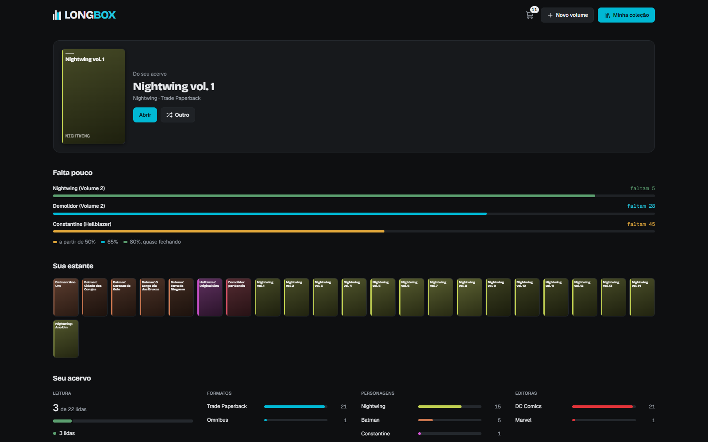

# Longbox

Biblioteca pessoal de HQs: os volumes que tenho na estante, as coleções em ordem de leitura, a
lista de edições de cada série e uma lista de desejos. Roda como um Claude Artifact e funciona
no PC, no tablet e no iPhone.



## O que faz

- **Acervo:** volumes com capa, formato, editora e personagem; filtros, busca e status de leitura.
- **Coleções:** volumes agrupados em ordem de leitura, reordenados arrastando as capas.
- **Séries:** a lista de edições de cada série, com o progresso ("faltam 5").
- **Lista de desejos:** separada do acervo; ao comprar, o volume passa para a estante.
- **Vários aparelhos:** quando dois aparelhos salvam ao mesmo tempo, o app junta as mudanças
  em vez de uma apagar a outra (`src/lib/mesclar.js`).

## Tecnologia

React 18, empacotado com esbuild num único `app.js`; GSAP nas animações; ícones Lucide.
Os dados ficam no banco do próprio Artifact.

## Rodar

```bash
npm install
npm run build      # gera dist/
npm test           # testes em tests/
npm run harness    # abre o app com dados de exemplo em http://localhost:8768
```

## Documentação

- `DESIGN.md`: a especificação atual (layout, dados, build, testes).
- `HISTORICO.md`: o registro de cada versão, com o porquê de cada decisão.

Desenvolvido com Claude Code e Codex.
